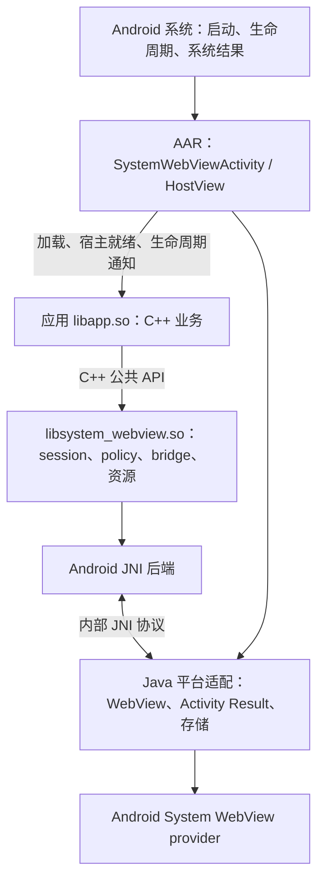
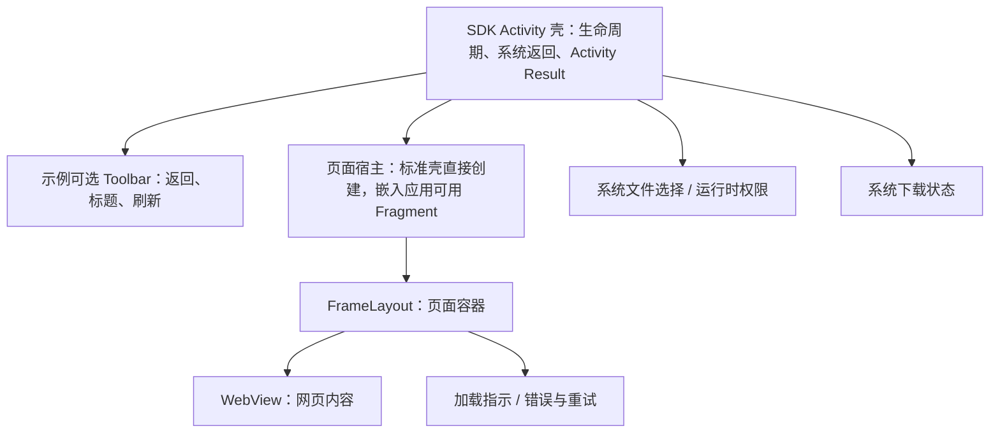

# Android 页面承载与界面方案调研

> 最后修改时间：2026-11-06 13:18 CST
> 文档版本：v5
> 修改说明：记录首个 Android demo 的落地结果、与提案的偏差以及仍未覆盖的契约。

## 结论

Android 后端与示例已经存在并在模拟器上跑通：`samples/android_demo` 能加载共享的 `demo.html`、由 C++ 拦截本地资源、完成双向 bridge，并处理页面窗口事件。实现方式与本文原方案一致：现有 C++ 核心不变，新增 `src/platform/android` JNI 后端和 Java 宿主适配；界面由原生 Android 视图提供，库不接管应用外壳。构建、运行与当前限制见 [Android 示例指南](../guides/android-demo.md)，与完整提案的差距见第 0 节。

Android 与 Windows/macOS 的关键差异仍然成立：`android.webkit.WebView` 不是可被 C++ 直接创建的原生视图，而是 Java 层对象。因此 Android 支持不能只新增一个 `.cpp` 后端，必须是三层结构：

1. 复用 C++ 状态机、policy、bridge 和资源管理，按下文扩展历史导航、异步权限与页面资源 URL 契约；
2. 新增 `src/platform/android` JNI 后端，实现 `IWebViewSession`、`IWebView`、`BridgeTransport` 和资源响应；
3. 新增 Java 21 编写的 Android 壳（AAR），负责 Activity/HostView、系统交互及真正的 WebView；应用业务编译为 native shared library，通过 C++ 库调用页面能力。

标准接入直接使用库提供的 Java Activity 壳，业务通过 C++ 入口接收宿主、创建 session 并驱动页面；应用无需自行实现 Java 业务控制器或 JNI 胶水。壳默认全屏承载网页，并提供返回、权限和文件选择的平台服务。示例可加原生工具栏；首版验证单页面，不新增通用 UI 组件库。

本文是实施提案，尚无 NDK 构建或设备实验结果。先完成端到端 spike，验证资源 URL、导航策略覆盖和 provider 能力，再确定可交付范围与工期。首版使用默认共享持久化 profile；MULTI_PROFILE 不提供非持久化保证，不能据此声明支持隐私会话。核心安全测试失败会阻止发布，可选能力失败则明确 Unsupported，具体见第 5.9 节。

> 2026-11-06 更新：首个 Android demo 已在模拟器上跑通，构建方式、验证结果和与本节计划的偏差记录在第 0 节。本文其余章节仍是完整交付目标，未标记为已实现的内容不代表当前代码已经具备。

## 0. 首个 demo 的落地结果（2026-11-06）

按用户要求，首轮目标放宽为“在已安装的 Android Studio 环境里让示例跑起来”，不追求完整 AAR 交付。实际结果：

| 项目 | 落地情况 |
| --- | --- |
| 构建基线 | `compileSdk = 36`、`targetSdk = 36`、`minSdk = 26`、NDK 28.2.13676358、CMake 3.31.6、AGP 9.5.0、Gradle 9.6.0 |
| 运行环境 | 模拟器 `Medium_Phone_API_36.0`，API 36 x86_64，系统 WebView 133.0.6943.137 |
| 后端位置 | `src/platform/android`，实现 `AndroidSession`、`AndroidView`、JNI 绑定与生命周期 |
| Java 适配位置 | `samples/android_demo/app/src/main/java/io/github/systemwebview`，与示例一起构建，尚未抽成 AAR |
| 业务入口 | `samples/android_demo/app/src/main/cpp/demo_bridge.cpp`，编译为 `libsystem_webview_android_demo.so` |
| 页面来源 | 复用 `samples/demo/resources/demo.html`，构建时复制；首次启动解包到 `filesDir/webview/demo` |
| 已通过验证 | 页面加载、`app://` 映射、C++ 资源拦截、双向 bridge、窗口关闭事件、干净构建 |

与第 3～6 节提案的偏差：

- 提案中的“SDK 提供 Java Activity 壳、业务编译为 libapp.so、随 AAR 发布”尚未实施。当前 Java 宿主与业务胶水都在示例工程内，职责边界与提案一致，但还没有 AAR、Prefab、R8 规则和 Java 21 约束。
- 提案要求首版扩展 `FileSelectionResult` 为 content URI、异步权限回调、发布资源可读 URL；本轮均未修改公共契约，对应能力直接返回 Unsupported。
- 提案的最低 API 29 调整为 26，以适配当前 SDK；`compileSdk` 采用 36。
- 提案要求 ARM64 与 x86_64 双 ABI；本轮只构建 x86_64，真机需要追加 `arm64-v8a`。

在把示例升级为可发布 SDK 之前，第 5.9 节的发布门槛仍然有效，尤其需要补齐发布资源 URL、文件选择、异步权限和 POST/导航覆盖的验证。

## 1. 代码与文档现状

| 证据 | 当前事实 | 对 Android 的影响 |
| --- | --- | --- |
| `src/platform/CMakeLists.txt` | 只处理 `APPLE`、`WIN32`，其他平台执行 `message(FATAL_ERROR ...)` | 必须增加 `ANDROID` 分支和 Android 源文件列表 |
| `src/webview/WebViewFactory.cpp` | 用 `__APPLE__` / `_WIN32` 直接构造平台 session | 增加 `__ANDROID__` 分支；仍保持编译期选择，不引入运行时插件 |
| `include/system_webview/system_webview.h` | `WebViewHost` 包含 `void* nativeHandle`、几何、`refresh`、`postToUi`、`observeChanges` | 可承载 `jobject`，但需要明确 Android 句柄类型、线程和生命周期 |
| `src/internal/HostView.h` | `ExternalHostView` 把 `WebViewHost` 适配为框架无关接口 | 宿主边界可以复用；其他契约缺口仍需单独修改 |
| `src/platform/macos/WkWebView.mm` | `attachNativeView` 通过宿主 `refreshHost()` 挂载；`close()` 有固定顺序 | Android 需要等价顺序：移出 ViewGroup、停止加载、注销 listener、`destroy()` |
| `src/platform/macos/WkWebViewSession.mm` | `WKURLSchemeHandler` 提供 `app://` 资源，`WKWebsiteDataStore` 提供 profile | Android 的资源拦截和 profile 能力不同，不能照搬 |
| `src/webview/Application.cpp` | `LocalBundle` 要求 `directory` 是已存在的文件系统目录 | APK 内的 `assets/` 不是文件系统目录，需要解包/复制或新增资源来源类型 |
| `src/webview/ResourceMapping.cpp` | 资源映射只接受 `app://<id>`，CSP 按 bundle 生成 | Android 若使用 `https://<id>.appassets.androidplatform.net`，必须在后端做 origin 映射 |
| `src/webview/WebResourceManager.cpp` | 打开资源时校验资源 origin、文档来源和 token；发布时返回绝对 `app://` URL | 请求入站映射之外，还需让发布结果成为网页可读取的 URL |
| `src/webview/WebViewPolicy.cpp` | `allowsBridge` 对 `app` scheme 使用 `allowedAppHosts`；权限决策是同步的 | Android 的 https 资源域必须映射回 `app://`，异步权限需要契约扩展 |
| `docs/arch/architecture.md` | 平台映射表只有 macOS、Windows 和 WebKit2GTK 设计，Linux 未实现 | 需要新增 Android 行、生命周期差异和能力矩阵 |
| `docs/reports/window-host-replacement-scope.md` | 明确 `void*` 句柄不能隐式解决 DPI、坐标系和线程问题 | Android 需要在宿主适配层显式处理 UI 线程、insets 和 jobject 生命周期 |

另外，公共接口目前没有历史导航方法：`IWebView` 只有 `navigate`、`loadDocument`、`stop`、`reload`。Android 的系统返回键、工具栏后退按钮和手势返回都依赖 `canGoBack()`/`goBack()`，这是界面方案必须先解决的契约缺口。

## 2. Android 平台约束

### 2.0 支持基线

Android 最低支持 API 29（Android 10），`minSdk = 29`；Java 版本固定为 21，构建使用 JDK 21。`compileSdk`、`targetSdk`、NDK、Gradle、Android Gradle Plugin 和 AndroidX WebKit 的具体版本须在 spike 中核验并记录，不能把最低运行 API 当作编译或目标 API。

构建链须支持 JDK 21，并验证 Java 21 源码及字节码经 D8/R8 处理后的兼容性。JDK 21 不代表 API 29 设备具备全部 Java SE 21 类库；实际使用的类库 API 仍受 Android 平台与 desugaring 支持范围约束。设备验收从 API 29 开始，不维护更低 API 的兼容路径；WebView provider 特性仍单独探测。

### 2.1 WebView 是 Java 视图

`android.webkit.WebView` 必须创建在带 `Looper` 的线程上（通常是主线程），并由 `ViewGroup` 承载。C++ 不能像 `HWND` 或 `NSView` 那样直接创建它，只能通过 JNI 调用 Java 层。JNI 需要：

- 在 `JNI_OnLoad` 保存 `JavaVM*`；
- 保存 Application context 全局引用；Activity 与 ViewGroup 引用按页面生命周期持有和释放；
- 按需 `AttachCurrentThread`，记录本方附加的线程并在退出时 detach；Java 异常转为错误或诊断后再清除，不能吞掉；
- 保证所有 `WebView` 操作都在 UI 线程执行。

### 2.2 页面承载在 Android View 树中

`WebView` 是 Android View，宿主应提供 `FrameLayout` 等 `ViewGroup`。原生窗口或 `ANativeWindow` 句柄不能替代 ViewGroup。若页面旁边还有视频或自定义渲染内容，使用同一 Activity 的 View 层级安排位置，并验证焦点、触摸分发和遮挡关系。

首版标准壳使用 Activity + FrameLayout，不强制 Fragment。已有 Android 应用可把 HostView 嵌入自己的 Activity/Fragment；Compose 使用 AndroidView 承载同一 HostView。三种接入共用同一后端，AAR 不引入 Compose 依赖。

### 2.3 WebView provider 存在版本碎片

Android System WebView 由 Google Play 或 OEM 更新，不同设备的 provider 能力差异明显。以下 AndroidX 特性通过 `WebViewFeature.isFeatureSupported()` 探测。bridge 所需的消息监听和 document-start 不可用时明确初始化失败；命名 profile、无响应通知按实际功能需求决定是否要求，首版默认 profile 不依赖 MULTI_PROFILE：

- `WEB_MESSAGE_LISTENER`：页面到原生的结构化消息，带 origin 和主框架信息；
- `DOCUMENT_START_SCRIPT`：文档开始时注入 bridge token，接近 macOS 的 `WKUserScriptInjectionTimeAtDocumentStart`；
- `WEB_VIEW_RENDERER_CLIENT_BASIC_USAGE`：渲染进程无响应/恢复通知；进程退出由支持范围内可用的 `onRenderProcessGone` 处理；
- `MULTI_PROFILE`：按 profile 隔离 cookie 和网站数据。

| 特性 | 最低 AndroidX WebKit | 用途 |
| --- | --- | --- |
| `WEB_MESSAGE_LISTENER` | 1.3.0 | 页面到原生的 bridge |
| `POST_WEB_MESSAGE` | 1.1.0 | 原生到页面的 bridge |
| `DOCUMENT_START_SCRIPT` | 1.9.0 | 文档开始注入 token |
| `MULTI_PROFILE` | 1.9.0 | profile 级 cookie/网站数据 |
| `WEB_VIEW_RENDERER_CLIENT_BASIC_USAGE` | 1.1.0 | 渲染进程无响应/恢复通知 |
| `WEB_RESOURCE_REQUEST_IS_REDIRECT` | 1.1.0 | 重定向标记 |

以上版本只表示 AndroidX WebKit 的 API 可用性，实际能否使用仍取决于设备上的 WebView provider。这与 Windows 后端检查 `ICoreWebView2_22` 是否可用的策略一致：能力不可用时明确初始化失败，并提示更新 WebView。

### 2.4 进程和页面生命周期

- `WebView` 必须在 UI 线程 `destroy()`，并且销毁后不能再使用；
- 渲染进程崩溃后，`WebView` 实例不可恢复，只能销毁并重建；
- Activity 重建时关闭旧页面并重建宿主，session 控制状态可独立于 Activity 保存；进程死亡后通过持久化状态恢复，ViewModel 本身不能抵抗进程死亡；
- 每个标签一个 `WebView`，内存占用明显高于桌面单页面场景，关闭标签时要及时销毁。

### 2.5 存储和权限

- 任意路径写文件受 scoped storage 限制，`DownloadTarget.filePath` 不能直接使用公共目录；
- 文件选择返回 `content://` URI，而不是文件系统路径；
- 相机、麦克风、通知等权限是 Android 运行时权限，需要 Activity 参与，无法由同步的 `decidePermission` 完成。

## 3. 推荐总体架构：Java 壳承载，C++ 库驱动

采用 Android embedding 的分工：AAR 提供 Java 壳和平台服务，业务应用编译成自己的 native shared library，通过 C++ 公共接口控制页面。这与 Flutter Android embedder 把 Activity、平台视图和事件转发放在 Android 层的分工相近；本项目使用系统 WebView，不引入 Flutter 引擎、Dart 或自绘渲染管线。



| 模块 | 负责 | 公共接入面 |
| --- | --- | --- |
| 应用 native library | 创建 session/application/view、业务 policy、bridge 消息、保存可恢复状态 | 链接 C++ 库并注册宿主生命周期回调 |
| C++ 核心与 Android 后端 | 页面状态、策略执行、资源授权、Java 对象所有权、JNI 翻译 | 现有公共 C++ 接口及 Android 宿主扩展 |
| Java 壳 | Activity 生命周期、ViewGroup、系统返回、Activity Result、输入法与系统栏 | 可直接声明使用的 SystemWebViewActivity；已有 Activity 可嵌入同一 HostView |
| Java 平台适配 | 创建/销毁 WebView，转发 clients 与系统结果，执行 C++ 已批准的操作 | JNI 内部协议，不另建一套 Java 业务 API |
| 示例 APK | 演示 C++ 应用入口、本地页面、权限和上传下载；可选原生工具栏 | 消费正式 AAR，不复制 SDK 实现 |

Java 壳属于库交付内容，不要求每个应用重写权限和文件选择接线。默认全屏承载网页，原生工具栏只是示例布局。平台能力的执行由壳提供，是否允许仍由 C++ policy 和宿主回调决定。

### 3.1 C++ 应用接入流程

以下名称和回调属于提案，尚未实现；最终签名在公共接口规格中确定。

1. 应用 Gradle 依赖 AAR 并启用 Prefab，CMake 链接 `system_webview::system_webview`，把业务编译为 `libapp.so`。Manifest 使用 SDK Activity，并以应用内静态 metadata 指定业务库名；不从 Intent 或网络输入选择 native library。
2. Java 壳先 `System.loadLibrary` 加载 SDK，再加载业务库。SDK 的 `JNI_OnLoad` 缓存 JavaVM、注册内部 native 方法；应用自己的 `JNI_OnLoad` 只调用 Android 扩展中的 `registerApplication` 注册生命周期回调，不创建 WebView、不执行阻塞业务。
3. Activity 在主线程准备 Application context、ViewGroup 和 Activity Result launcher，调用 SDK 初始化，再发出 `onHostReady(WebViewHost)`。应用在第一次 C++ 宿主就绪回调中创建 Persistent session；重建时复用仍存活的 session，为新宿主创建新 view，设置 policy 和回调并打开 application，布局有效后挂载。
4. 页面导航、bridge、文件选择和权限事件都进入 C++。policy 允许且宿主接受后，Java 壳执行相应平台请求，携带宿主代次和请求标识把结果送回原请求。
5. Activity 销毁时先发出 `onHostClosing`，让 C++ 解除挂载并关闭该宿主的 view。SDK 还要幂等兜底关闭遗漏的 view，再释放宿主引用；配置重建后再次发出新的 `onHostReady`。session 可继续存在，已关闭的 view 不复用。

首版注册一个进程级应用回调接收器，每次宿主就绪生成独立宿主标识。接入方只需 C++ 入口、Gradle/Manifest 配置和网页资源，不必编写业务 Java 类或自行查找 JNI 类与方法。已有原生 Android 应用可把同一 HostView 放进自身 Activity，复用同一生命周期转发器，不维护第二套启动实现。

### 3.2 初始化与对象所有权

Android 专用入口放在拟新增的 `include/system_webview/android_host.h`。公共业务接口只暴露注册、宿主就绪/关闭及必要的平台请求转发；JavaVM、JNIEnv、jobject 的初始化和 ViewGroup 适配留在 SDK 内部，不要求普通 C++ 消费方管理 JNI 引用。

`WebViewHost.nativeHandle` 在 Android 后端内部是 ViewGroup 的全局引用，宿主适配器拥有它；后端借用它并持有宿主生命周期凭据。后端拥有真正的 WebView，负责唯一一次 destroy。进程级组件只保留 Application context；Activity 和 ViewGroup 引用随宿主释放。Activity 的 onDestroy 不调用进程级 shutdown，以免破坏其他宿主或配置重建。

`postToUi` 通过主 Looper 的 Handler 投递，不依赖尚未 attach 的 View.post 队列。布局和 attach listener 在宿主存活期间观察变化；短暂 detach 不能撤销所有观察导致后续 reattach 丢失通知。宿主关闭后注销全部 listener，排队动作通过宿主标识与代次检测失效。

### 3.3 线程与资源并发

采用 Android 常见的主线程状态机、后台 I/O 分工，JNI 方法不因来自 C++ 就获得线程豁免。

| 工作 | 执行线程 | 同步规则 |
| --- | --- | --- |
| session/view 创建、导航、历史查询、挂载、关闭及业务回调 | Android 主线程 | C++ 工作线程使用宿主 postToUi；错误线程调用须明确报告，不在同步 API 内偷偷切线程等待 |
| URI 读取、资源解包、文件快照及流读取 | 后台线程 | 返回主线程前检查请求是否仍有效，不在 UI 线程复制大文件 |
| shouldInterceptRequest | WebView 的后台回调线程 | 只执行线程安全资源查找和流打开，不直接调用业务回调或同步等待 UI |
| 权限/文件选择完成回调 | 可从后台完成 | SDK 统一投递主线程，至多消费一次；关闭后结果失效 |

现有资源管理器的索引和文档状态不能无保护地在这些线程之间共享。实施时在共享资源管理器中以短时互斥保护索引、token 与撤销状态；open 校验并取得不可变快照租约后释放锁，再执行文件 I/O。导航/close 在同一同步规则下撤销后续打开；已取得租约的读取按既有语义完成，最后一个租约释放后才能删除快照。锁内不得调用 JNI、宿主回调或等待主线程。

这项调整须覆盖已有后端，并测试 open 与 release、导航、close 并发，以及慢速读取时快照不会提前删除。同步 publishFile 允许在后台调用，任务期间必须保持资源管理器对象存活，不能与析构并发：先在锁内取得文档代次和路径约束，锁外复制快照，再加锁核验代次并登记；期间若发生导航或关闭，删除未发布副本并返回失败。成功后将发布结果投递主线程发送给页面，不能在后台直接调用 bridge 或 WebView。

### 3.4 session 与网站数据

首版允许多个 session，但它们显式共享进程默认的持久化 WebView profile：同 origin 的 cookie、localStorage 等网站数据可共享，session 不等于独立账号或隐私容器。C++ 对象、页面回调和资源 token 仍分别管理；关闭 session 不清除共享 profile 的网站数据。

`profilePath` 首版只接受空值，非空立即初始化失败；Ephemeral 立即失败，PrivateProfile 为 Unsupported。需要独立账号存储的业务不在首版支持范围，不能回退到共享 profile 冒充隔离。命名 profile 是后续明确需求，不作为首版隐式升级路径。数据清除必须是应用明确发起的共享数据操作，不能挂在单个页面的销毁路径上。

## 4. 在 Android 应用中的呈现

### 4.1 首版页面结构

标准壳启动后全屏显示 C++ 应用打开的网页，系统返回和权限、文件选择由壳转发。用于验收的示例布局增加原生标题、返回、刷新、不确定进度条及错误重试，展示库事件如何驱动界面；这些控件不成为业务应用的强制 UI。下载交由系统服务执行并查询状态。



`SystemWebViewHostView` 是拟新增的 FrameLayout 容器，负责生成 `WebViewHost` 和通知尺寸、挂载状态变化。真正的 WebView 由 JNI 后端创建并持有；容器只承载它，避免宿主与后端各创建或销毁一次。Activity Result 接线随 SDK 壳交付；工具栏和错误页保留在示例中，由 C++ 页面事件驱动。

### 4.2 Android 交互规则

| 操作或状态 | 应用行为 | 后端配合 |
| --- | --- | --- |
| 返回按钮、系统返回手势 | 有网页历史时回退，否则退出当前页面；全屏视频先退出全屏 | 提供历史查询与回退，状态变化后更新返回回调是否启用 |
| 刷新 | 重载当前页面，清除上次错误提示 | 发出本次导航的加载事件 |
| 页面加载 | `Started` 显示加载指示，终态隐藏；不把事件阶段伪装成百分比 | 只有增加真实进度通知后才使用确定进度条 |
| 文件上传 | C++ 委托壳注册的系统选择服务，取消时完成取消回调 | 校验系统返回的 content URI 和读取授权，直接回传原 WebView |
| 相机、麦克风和定位 | policy 允许后，再说明用途并按需申请系统权限 | 授权结果返回时检查页面、请求和 Activity 仍有效 |
| 下载 | 允许后提交系统下载任务，展示可查询的任务状态 | 附带正确 profile 的认证 cookie，校验目标路径 |
| 新窗口 | 首版默认拒绝；确有业务需求时新增页面容器接管子 view | 子 view 未被接管即关闭，复用 profile 和策略 |
| 全屏视频 | 壳收到自定义 View 时提供临时容器，退出后恢复布局 | 转发 onShowCustomView/onHideCustomView，销毁时兜底清理；媒体资源播放范围另行实测 |

工具栏不会自动解决系统栏、输入法或手势返回。根布局须分配 `WindowInsets`，状态栏与导航栏各留一次安全区，输入法出现时缩小内容区并保持输入框可见。返回操作接入 `OnBackPressedDispatcher`，无障碍标签、字体缩放和触摸目标在设备上检查。网页默认占满已扣除安全区的容器。

### 4.3 创建、离开与重建

1. Java 壳加载 SDK 和应用 native library，完成初始化后在主线程通知 C++ 宿主就绪。C++ 创建 session 时显式选择 SessionMode::Persistent；现有默认 Ephemeral 在 Android 上初始化失败。
2. SDK Activity 在创建阶段注册文件选择、权限 launcher，并创建容器；C++ 业务取得宿主后配置 policy、回调并挂载 view。嵌入应用通过同一生命周期转发器接入自身 Activity/Fragment。
3. Activity 或嵌入容器的 View 生命周期结束前，由宿主关闭通知驱动 C++ 先解除原生挂载，再调用 close()。由后端统一停止加载、撤销 token、注销 listener、移除并 `destroy()` WebView；随后释放容器的全局引用。延迟回调须识别已关闭或已替换的页面。
4. 配置变更后创建新的容器与 WebView。ViewModel 可保留不含 Activity/View 引用的 session 控制状态；旧 WebView 与宿主不得随之保留。权限、文件选择的未完成请求按原页面失效处理。
5. 进程死亡后所有对象都会丢失。应用通过 SavedStateHandle 或保存的业务状态恢复允许恢复的 URL；表单、JS 堆和未完成授权不承诺恢复。持久化 profile 的磁盘数据与页面状态分别处理。

已有 Compose 应用也使用相同所有权规则：创建时挂载一次，释放 AndroidView 时关闭一次；普通重组只同步状态，不重复创建、挂载或销毁 session。

## 5. Android 后端映射

| 公共概念 | Android 实现 | 注意事项 |
| --- | --- | --- |
| Session/profile | `CookieManager`、`WebStorage`、`WebViewDatabase`；新 provider 使用 AndroidX `ProfileStore`/`Profile` | 旧 provider 上 cookie 和网站数据是进程级共享，无法按 session 隔离；`setProfile` 必须在 WebView 其他操作前调用 |
| `SessionMode::Ephemeral` | 首版 Unsupported，初始化时明确失败 | `MULTI_PROFILE` 仅隔离命名 profile，不保证不落盘；退出删除也无法覆盖进程被杀 |
| `profilePath` | 首版只接受空值并使用默认持久化 profile | 现有字段未定义 Android 语义；非空时明确失败，不擅自解释成 profile 名称；命名 profile 接入另行定义 |
| 创建 view | 在 UI 线程创建 `WebView`，设置 `WebSettings`，加入宿主 `ViewGroup` | 不能在非 Looper 线程创建；创建前必须已拿到 Application context |
| `attachNativeView` | `addView(webView, MATCH_PARENT, MATCH_PARENT)`；`detachNativeView` 执行 `removeView` | 挂载前调用 `refreshHost()` 读取最新几何 |
| `LoadEvent` | `onPageStarted` → `Started`；`onPageCommitVisible` → `Committed`；`onPageFinished` → `Finished`；主框架 `onReceivedError` → `Failed` | WebView 没有稳定的原生 navigation ID，需要用单调计数近似；重定向通过 `WebResourceRequest.isRedirect()` 标记 |
| 导航策略 | 原生导航入口先检查 policy；网页导航按 `shouldOverrideUrlLoading` 的覆盖范围检查 | POST 不触发该回调，不能视为完整等价；见第 5.8 节 |
| 新窗口 | `WebSettings.setSupportMultipleWindows(true)` + `WebChromeClient.onCreateWindow` + `WebViewTransport` | 子 WebView 必须复用同一套 clients；宿主未接管时销毁子 view |
| 权限 | `onPermissionRequest`（相机/麦克风）、`onGeolocationPermissionsShowPrompt` | 需要异步宿主回调；同步 `Allow` 不足以完成 Android 运行时权限流程 |
| 文件选择 | onShowFileChooser + Activity Result，直接传 content URI | 扩展 FileSelectionResult.uris，与 paths 互斥，保持授权和请求生命周期 |
| 下载 | `setDownloadListener` + `DownloadManager` | 从正确 profile 的 CookieManager 读取包括 HttpOnly 在内的 cookie，再显式转交；`blob:`/`data:` 首版 Unsupported |
| Bridge 入站 | `WebViewCompat.addWebMessageListener`，指定允许的 origin，校验 `isMainFrame` 和 document token | 比 `addJavascriptInterface` 安全；旧 provider 不支持时 fail closed；document-start 脚本用 `if (window.top !== window) return;` 预置语句只注入顶层框架 |
| Bridge 出站 | `WebViewCompat.postWebMessage` 或 `evaluateJavascript` 调用 `window.__systemWebViewReceive` | `postWebMessage` 的 `targetOrigin` 必须是真实的 asset 域，不是 `app://`；需要主线程 |
| Document token | `WebViewCompat.addDocumentStartJavaScript` 注入 `bridgePageScript()` | 需要 `DOCUMENT_START_SCRIPT`；不可用时初始化失败，避免竞态 |
| `LocalBundle` | `WebViewAssetLoader` 提供 `https://<id>.appassets.androidplatform.net` 资源 | 后端把该 https origin 映射为 `app://<id>`，再做 policy、bridge、资源校验 |
| 已发布资源 | `shouldInterceptRequest` 返回带状态码、`Content-Range` 和 `Content-Type` 的 `WebResourceResponse` | 大文件/媒体随机访问能力有限；token 失效、文档切换、close 都要撤销 |
| 运行时故障 | `WebViewRenderProcessClient` + `onRenderProcessGone` | 渲染进程死亡后必须销毁并重建 WebView；浏览器进程退出没有等价公开 API |
| 清理数据 | 使用当前 profile 的数据接口；默认 profile 的清理属于共享操作 | 不在单个 session 关闭时执行全局清理；命名 profile 不等于临时 profile |

### 5.1 逻辑 URL、页面 URL 与资源隔离

C++ 策略和资源查找继续使用逻辑 `app://<id>`；WebView 加载本地内容使用真实 `https://<id>.appassets.androidplatform.net`。同一 session 内每个应用分配独立 HTTPS origin，id 到域名标签的编码规则须明确并测试，不能把任意 id 直接拼进域名。禁止用同域 `/app/<id>/` 路径代替 origin 隔离：路径不同仍共享 localStorage 等存储，CSP `'self'` 也无法区分应用。

两类 URL 必须区分用途：

| 边界 | 提案行为 |
| --- | --- |
| `navigate(app://...)` | 在调用 `loadUrl` 前检查逻辑 URL 的 policy，通过后转成真实页面 URL |
| `LoadEvent` / `committedUrl` / policy | 真实本地域名严格反向映射为注册的逻辑 origin；其他 HTTPS 不映射 |
| `shouldInterceptRequest` | 真实 URL 转为逻辑资源请求，再执行目录约束、token、来源、Range 检查 |
| bridge 入站 | 使用回调提供的真实 source origin 和 `isMainFrame`，检查后反向映射，再验证 document token |
| document-start / message listener 的允许 origin | 使用真实页面 origin；不以宽泛通配符开放本地应用 |
| `PublishedResource.url` | 在 Android 上返回网页可读取的真实 HTTPS URL；C++ 资源索引和请求校验仍保留逻辑 URL |
| 页面 DOM、fetch、CSP、postMessage | 使用真实页面 origin；相对 URL 自然解析到该 origin |

现有 `WebResourceManager::publishFile()` 直接返回绝对 `app://.../resource/<token>`。该值通过 JSON bridge 送到网页后，用作 `img.src`、视频源或 `fetch` 不会经过原生 `navigate()`；仅转换导航与入站请求无法解决它。

建议在资源发布结果形成处增加后端内部的 URL 转换入口，Android 返回真实页面 URL，已有后端保持原值。`PublishedResource.url` 的公共语义应明确为“供网页读取的不透明地址”，应用可原样通过 bridge 传递，不能依赖固定 scheme 或自行拼接。资源管理器、view 状态绑定及其测试需要一起调整；这属于核心契约变更，不能声称核心完全不动。不要遍历 JSON 任意字符串替换 URL。

网页源码中的显式 `app://` 链接不在该发布入口覆盖范围内。本地应用应使用相对路径，或使用宿主返回的页面可读 URL；任意硬编码 `fetch('app://...')` 的跨平台兼容暂不承诺。远程页面读取发布资源时，还需验证来源授权及 CORS，不能靠允许所有 origin 解决。

资源请求来源也是 spike 的阻塞项：`shouldInterceptRequest` 不直接提供等价于 message listener 的 source origin 信息。不得把当前顶层页面 origin 或可缺失的 Referer 当成已验证的请求来源来填充 `ResourceRequest.sourceOrigin`。必须覆盖跨 origin iframe 的访问拒绝和导航后旧请求失效；若无法保留现有来源约束，按第 5.9 节阻止首版发布，不能自动降为弱校验。

`WebViewAssetLoader` 提供 HTTPS 下的资源处理入口，SPA fallback 仍需接入现有资源解析逻辑。自定义 handler 对保留域中的未知路径、失效 token 和拒绝请求应返回明确错误响应，不能返回 null 后落到网络。`app://` 自定义 scheme 的子资源行为作为备选实验，未经验证不作为发布方案。

### 5.2 `LocalBundle` 与 APK assets

`createApplication` 会执行 `std::filesystem::canonical(bundle.directory)` 并检查它是目录。APK 里的 `assets/` 不是文件系统目录，因此 Android 有两种可行路径：

1. **v1：首次运行时解包**。把 APK assets 复制到 `filesDir/webview/<app-id>/`，再以该目录构造 `LocalBundle`。优点是公共 API 不变；缺点是多占一份磁盘、首次启动有复制成本，且需要处理版本升级后的重新解包。
2. **长期：新增资源来源类型**。例如 `AssetBundle { assetRoot, entryDocument, spaFallback, externalNetworkAccess }`，由 Android 后端直接交给 `WebViewAssetLoader.AssetsPathHandler`。这会修改公共 API，需要 ADR/spec 批准，并同步 macOS/Windows 的“不支持时报告 Unsupported”行为。

建议先用方案 1 打通端到端，再根据接入反馈决定是否引入 `AssetBundle`。复制在后台执行，成功后再开放页面，并记录资源版本以处理升级。Gradle 的 `noCompress` 只控制 APK 内压缩方式，不能把 APK assets 变成安装后的普通目录，也不能替代运行时复制。

### 5.3 文件选择：直接使用 content URI

推荐使用 Android 原生的 URI 流程，不默认复制文件到缓存。`onShowFileChooser` 最终接收 `Uri[]`，系统选择器返回的 content URI 可以在有效授权下直接交给 WebView；把 URI 反查成磁盘路径既不可靠，也不适用于云端文档。

现有 `FileSelectionResult.paths` 只表示文件系统路径。建议扩展公共结果，增加 `uris`，明确以下规则，并同步所有后端、结果校验和测试：

- Selected 必须恰好提供一种非空结果：paths 或 uris，不能同时填写。取消和无效结果不能携带任何文件。
- Android 首版接受获得有效读取授权且通过校验的 content URI；不把 URI 字符串塞进 paths，也不把任意 file URI 转为可上传文件。其他后端继续使用 paths，对不支持的 uris 返回 InvalidResult。
- SDK 壳注册 Activity Result launcher，按单选/多选和 MIME 请求打开系统选择器。C++ 的 onSelectFiles 仍是公共决策入口；示例在其中调用 Android 宿主扩展提供的默认选择服务，业务可拒绝或替换。Java 只执行已委托的选择，不绕过 C++ 回调。
- 选择结果视为不可信输入：检查 scheme、来源授权、数量与请求约束，拒绝指向应用敏感私有数据的伪造 URI。通过后在主线程完成 C++ 请求并调用原 WebView 的 ValueCallback，不能交给后来创建的页面。
- 取消、宿主销毁、页面切换或新请求替换旧请求时，以空值完成尚有效的原生回调并释放本方请求资源。已回传 URI 不能仅因文件选择器关闭就撤销授权；读取生命周期按 Android 授权规则处理。默认不调用 takePersistableUriPermission，跨重启保存授权须另有业务需求。

目录选择、直接拍摄和录制不在首版默认选择器范围；遇到不能表达的请求明确取消并报告不支持。库首版不建立上传缓存，也无副本清理任务。若未来业务明确需要离线副本，再单独设计后台复制、容量和清理规则。

### 5.4 下载与 scoped storage

Android 存储方案需要区分路径权限与下载 API 的实际写入能力：

- 应用私有目录：应用可直接写入 `getFilesDir()`、`getExternalFilesDir()`，但不代表 DownloadManager 支持所有这些路径；
- 缓存目录：应用可写 `getCacheDir()`，缓存随时可能被回收，不适合作为持久下载承诺；
- 通过 MediaStore 或 `DownloadManager` 写入公共下载目录（需要用户可见的下载请求）。

建议映射：

| 公共策略 | Android 行为 |
| --- | --- |
| `DownloadHandling::Cancel` | 直接取消 |
| `DownloadHandling::BrowserDefault` | 使用 `DownloadManager` 写入公共 Downloads，并显示系统通知 |
| `DownloadHandling::TargetPath` | 首版 Unsupported，不改写为默认下载 |

下载请求的 `documentUrl`/`origin` 来自对应的 committed 文档。`DownloadManager` 不自动共享 WebView 的 cookie，需要从当前 profile 对应的 CookieManager 调用 `getCookie(downloadUrl)`，并显式添加 Cookie 和 User-Agent。HttpOnly 限制网页脚本读取，不禁止原生 CookieManager 获取；不能将其记为认证必然失败的原因。

认证验收至少包含 HttpOnly 登录 cookie、重定向后 cookie 转发边界和失败状态查询；将来接入命名 profile 时再增加非默认 profile 的隔离测试。独立下载栈仍可能与 WebView 的认证方式不同，未验证的场景不声明支持；认证诊断不记录 cookie 内容。`blob:` 和 `data:` 首版报告 Unsupported，不额外引入页面转存协议。

`DownloadManager` 的显式目标 URI 有平台限制，不能因为路径位于 filesDir 就假定它可写。首版不承诺 DownloadTarget；按需写应用私有文件或 SAF 目标属于后续独立功能，不影响已验证的系统默认下载。

### 5.5 权限需要异步回调

现有接口：

```cpp
virtual PermissionDecision decidePermission(const PermissionRequest& request) const;
```

这是同步决策。以相机和麦克风的网页权限请求为例，Android 侧需要：

1. 判断是否已有权限；
2. 没有时向 Activity 发起运行时权限请求；
3. 等待 Activity Result 的权限结果；
4. 对仍有效的请求调用 `PermissionRequest.grant()`/`deny()`；定位使用独立的 geolocation 回调。通知首版 Unsupported，不能把系统通知授权直接当作 Web Push 支持。

后端无法替应用启动 Activity Result，因此需要把决定权交给宿主。建议在 `WebViewHostCallbacks` 增加异步完成回调（名称待定）：

```cpp
struct PermissionResolution
{
    PermissionDecision decision = PermissionDecision::Deny;
    std::string error;
};

using PermissionCompletion = std::function<void(PermissionResolution)>;

struct WebViewHostCallbacks
{
    // ...existing code...
    /// 空回调表示后端直接按 policy 结果处理；非空时宿主必须调用 completion 一次。
    std::function<void(const PermissionRequest&, PermissionCompletion)> onResolvePermission;
};
```

policy 仍先给出 `Allow`/`Deny`/`Unsupported`；只有 `Allow` 且宿主提供了回调时，后端才询问宿主。没有回调时，已获系统权限才可 grant，否则拒绝。完成回调至多生效一次；收到取消、页面导航、close 或宿主销毁时使原请求失效，迟到结果不得授权新页面。同步 policy 的拒绝不能被宿主回调覆盖。

### 5.6 返回/前进和历史

Android 的返回键和工具栏后退按钮需要页面历史。当前 `IWebView` 没有 `canGoBack()`/`goBack()`/`canGoForward()`/`goForward()`，应用只能自己维护 URL 栈，这会丢失表单提交历史、重定向和滚动位置。

建议扩展公共接口（所有后端一起实现）：

```cpp
enum class WebViewCapability : int
{
    // ...existing code...
    NavigationHistory ///< 后端支持可查询、可驱动的历史导航。
};

class IWebView
{
public:
    // ...existing code...
    virtual bool canGoBack() const = 0;
    virtual bool canGoForward() const = 0;
    virtual void goBack() = 0;
    virtual void goForward() = 0;
};
```

在 Windows 上映射为 `ICoreWebView2::GoBack/GoForward/CanGoBack/CanGoForward`，macOS 映射为 `WKWebView` 的 `goBack:/goForward:/canGoBack/canGoForward`，Android 映射为 `WebView` 的同名方法。没有历史能力的后端（如果未来出现）返回 `false`/no-op，并通过 `supports(NavigationHistory)` 报告。

历史查询之外，公共宿主回调增加 `onHistoryChanged(bool canGoBack, bool canGoForward)`，名称与签名为提案。Android 后端在初次就绪、`doUpdateVisitedHistory`、主框架导航终态以及历史操作后重新查询 WebView，仅在状态变化时于主线程发出通知。壳据此更新 OnBackPressedDispatcher 的回调是否启用；真正处理返回时再次查询，先退出全屏，再回退网页，无历史则暂时禁用本回调并交给系统分发，避免递归。

SPA 的 pushState、replaceState、hash 与 back/forward 必须列入设备验收，不能假定 onPageFinished 覆盖它们。若 provider 的通知存在缺口，先补齐状态同步再声明历史能力通过，不维护与 WebView 分离的 URL 栈。已有后端同步实现相应历史状态通知，保持公共接口一致。
这是 Android 界面可用性的硬前提：历史查询、操作和状态通知共同通过验收后，才声明 NavigationHistory 支持。

### 5.7 首版目标能力矩阵

本表是实现目标，不是已验证状态。所有 Supported 均以对应设备测试通过为前提，运行时 supports 还需结合 provider 和宿主服务。标准壳提供权限、文件选择的默认平台服务，嵌入宿主缺少对应服务时如实报告不支持。

| 能力 | Android 首版目标 | 依据 |
| --- | --- | --- |
| `PersistentProfile` | Supported | `CookieManager`/`WebStorage` 默认持久化 |
| `PrivateProfile` | Unsupported | 命名 profile 隔离不满足非持久化契约；不得用退出清理替代 |
| `FileSelection` | 目标 Supported | SDK 壳提供 Activity Result 服务，uris 契约与授权验证通过后报告支持 |
| `DownloadDefault` | Supported | `DownloadManager` |
| `DownloadTarget` | Unsupported | 首版只交付系统默认下载，不实现自定义目标路径 |
| `Camera` / `Microphone` | Supported（需要异步权限） | `onPermissionRequest` |
| `Location` | Supported（需要异步权限） | `onGeolocationPermissionsShowPrompt` |
| `Notifications` | Unsupported | 首版不提供 Web Push；系统下载通知不等于网页通知权限 |
| `Clipboard` | Unsupported | WebView 没有与桌面权限模型等价的页面剪贴板授权事件 |
| `NavigationHistory` | Supported | `WebView.canGoBack/goBack` |

如果新增 `NavigationHistory` 会改变公共枚举，需要同步更新文档、示例和三个后端；这应作为独立的小规格，而不是塞进 Android 后端提交。

### 5.8 导航策略的覆盖边界

`shouldOverrideUrlLoading` 不会收到应用调用 `loadUrl()` 发起的导航，也不接收 POST 导航。不能只靠它保证所有请求在加载前经过 `decideNavigation`。

| 导航入口 | 处理要求 | 验收案例 |
| --- | --- | --- |
| C++ `navigate`、文档加载、重载与历史操作 | 各原生入口明确 policy 检查位置；映射后的本地 URL 仍以逻辑 origin 决策 | 宿主请求被禁止的 URL 时不开始加载 |
| 网页链接、JS 导航及回调可见的重定向 | 在 `shouldOverrideUrlLoading` 中检查；允许时直接返回 false，不重复 loadUrl | 被禁止的链接与重定向被拒绝，允许导航只发生一次 |
| 表单 POST | 回调缺口作为阻塞项；`shouldInterceptRequest` 不是完整导航 policy 替代，也不提供请求体 | 用自定义 policy 拒绝 HTTPS 目标，测试 POST 是否仍抵达测试服务器 |
| 子框架、重叠导航、后退前进 | 检查 origin、导航 ID 与文档 token，区分旧导航回调 | 跨 origin iframe 和旧页面不能沿用当前页权限 |

本地 bundle 的响应级 CSP `form-action` 可限制表单目标，但无法替代远程页面和任意自定义 policy。JS submit listener 也不能作为安全保证。如果 spike 找不到满足契约的原生覆盖方案，按第 5.9 节阻止首版发布；后续变更契约须单独决策，不能在本方案中自动放宽为尽力检查。

### 5.9 首版发布门槛与失败处理

“最佳方案”在本文指采用 Android 官方平台机制，并为项目的安全契约作出明确取舍，不表示任何框架可以消除 WebView 的平台限制。首版按以下规则交付，不在实验失败后临时换成弱校验实现。

| 范围 | 首版决定 | 未通过的处理 |
| --- | --- | --- |
| Java 壳加载应用库、生命周期、主线程、重建与 JNI 对象释放 | 必须支持 | 阻止 Android 首版发布 |
| 本地页面、origin 隔离、bridge 授权与 document token | 必须支持 | 阻止发布；不以同域路径或宽泛 origin 规则替代 |
| 已发布资源的来源校验、撤销和并发读取 | 必须保持现有安全契约 | 阻止发布；不填造 sourceOrigin，不悄悄弱化契约 |
| 导航 policy 的原生入口、网页导航和 POST 拒绝 | 必须通过明确的拒绝用例 | 阻止发布；若平台无法满足，另行批准契约变更，本文不授权放宽 |
| 系统返回、历史操作与 SPA 状态同步 | 必须支持 | 阻止发布，避免默认壳错误退出页面 |
| 文件选择、默认下载、相机/麦克风、定位 | 分别作为可选能力验证 | 某项未通过就将其标为 Unsupported，保留其他已验证能力；对应操作必须返回明确失败 |
| 独立账号 profile、Ephemeral、DownloadTarget、网页通知、剪贴板授权 | 首版不交付 | 初始化或请求时明确拒绝，不建立替代实现 |
| 多标签、弹窗、目录选择、拍摄录制与跨重启 URI 授权 | 首版不交付 | 默认拒绝请求，后续按实际业务独立设计 |

目标能力、实现结果与运行时探测分别记录。可选能力的测试失败只改变对应能力报告，不允许使核心安全测试失败仍被记为“降级通过”。设备覆盖 API 29 和一个较新版本，同时验证压缩 Release 下的 JNI 入口和 C++ 应用注册。

## 6. 构建与打包

### 6.1 CMake 接入

```cmake
if(ANDROID)
    set(SYSTEM_WEBVIEW_PLATFORM_SOURCES
        ${SYSTEM_WEBVIEW_SOURCE_DIR}/src/webview/PathSecurity.cpp
        ${SYSTEM_WEBVIEW_SOURCE_DIR}/src/platform/android/AndroidJni.cpp
        ${SYSTEM_WEBVIEW_SOURCE_DIR}/src/platform/android/AndroidSession.cpp
        ${SYSTEM_WEBVIEW_SOURCE_DIR}/src/platform/android/AndroidView.cpp
        PARENT_SCOPE)
endif()
```

`src/CMakeLists.txt` 增加 `elseif(ANDROID)` 分支并链接 `android`、`log`。`WebViewFactory.cpp` 增加 `#elif defined(__ANDROID__)`。`src/webview/PathSecurity.cpp` 的通用实现可以复用，但需要确认 Android 上 `std::filesystem` 和 NDK 的行为。

### 6.2 AAR + Prefab

对 C++ 消费方，发布带 Prefab 的 AAR，包含 Java 壳、native 库、公共头文件、Manifest 合并项及 JNI 所需 consumer R8 规则。业务 libapp.so 由应用自行构建并随 APK 打包，不放进 SDK AAR：

```
system-webview-android.aar
├── AndroidManifest.xml
├── classes.jar                 # Java Activity 壳、HostView、内部 JNI 与系统服务
├── jni/arm64-v8a/libsystem_webview.so
├── jni/x86_64/libsystem_webview.so
├── prefab/modules/system_webview/{headers,libs,abi.json}
└── prefab/prefab.json
```

首版统一使用 AAR + Prefab，不并行维护独立 Android CMake 安装包。打包要求：

- ABI：arm64-v8a 用于设备，x86_64 用于模拟器；首版不交付 32 位 ABI；
- STL：shared 库使用 `c++_shared` 时，AAR 需要一起打包 `libc++_shared.so`；Prefab 可以声明依赖；
- Android 基线：`minSdk = 29`（Android 10）；AndroidX WebKit 版本须兼容该最低 API，provider 能力另行探测；
- Java 基线：JDK 21；选择支持该 JDK 的 Gradle/Android Gradle Plugin 组合，并验证 Java 21 编译、D8/R8 和所用类库的兼容性；
- 界面依赖：SDK 使用 Java 21、Android Views 与 AndroidX Activity；Fragment/Compose 是嵌入应用自己的选择，不强制引入。

### 6.3 第三方依赖

现有核心依赖 `nlohmann/json`（公共头文件）、`ada`、`utf8proc`、`simdutf`（私有静态库）。这些库的 CMake 都是通用实现，没有发现 Android 专用分支，但必须在 spike 中实际用 NDK 构建验证：

- `simdutf` 的 arm64 NEON 和 x86_64 路径；
- `ada` 的 URL 解析在 Android 上的编译和运行；
- `utf8proc` 的静态 PIC 构建；
- NDK 的 libc++ 对 C++20 `<format>` 的支持（Android 后端可以避免 `std::format`，但核心/测试若引入需确认）。

如果某个依赖在 Android 上不可用，不能默默换实现；应记录为阻塞项，并按项目规则新增替代范围调研。

### 6.4 测试

- 核心 C++ 契约测试可以在 Android 上编译，但需要可执行环境；建议用 GTest + `adb shell` 运行，或封装成 instrumentation APK；
- WebView 行为测试使用 AndroidJUnitRunner + 设备/模拟器，覆盖：壳加载与 C++ 注册、创建/挂载/卸载、配置变更、共享 profile、SPA 历史通知、POST 拒绝、bridge 拒绝、origin 隔离、发布 URL 的 DOM/fetch/Range、资源并发撤销、跨 origin iframe 拒绝、文件 URI 授权与取消、权限晚到回调、HttpOnly 认证下载和渲染进程终止；
- 模拟器的 WebView 版本可能较旧，必须记录 provider 版本和 `WebViewFeature` 结果，像 Windows Runtime 证据表一样区分“编译通过”“单元测试通过”“设备 E2E 通过”；
- 至少覆盖一个 API 29 设备/镜像和一个较新 API 级别，记录真实 WebView 版本；构建证据包含 JDK 21、Gradle/Android Gradle Plugin 版本和 Java 编译配置。

## 7. 实施阶段

| 阶段 | 内容 | 验收 |
| --- | --- | --- |
| 0. 技术 spike（2–3 天起，遇阻重估） | NDK 构建；Java 壳加载 C++ 应用；单页面；双向 bridge；document-start；资源 URL 与并发；origin 隔离；POST 拒绝；请求来源校验 | 启动和业务回调可用；核心拒绝与资源测试通过；记录 provider 与 feature；按第 5.9 节判定阻塞 |
| 1. 契约扩展（1 周） | C++ 应用注册与宿主生命周期、线程约束、历史通知、异步权限、uris、资源 URL 与共享 Persistent 语义 | 按发布门槛批准范围；已有后端兼容与回归方案明确 |
| 2. Java 壳（1.5–2 周） | Activity/HostView、内部 JNI、clients、asset loader、message listener、Activity Result、系统默认下载 | C++ 应用无需业务 Java 代码即可启动；生命周期和 URI 授权测试通过 |
| 3. C++ JNI 后端（1.5–2 周） | `JNI_OnLoad`、`AndroidSession`、`AndroidView`、`BridgeTransport`、origin 映射、资源响应、能力查询、关闭顺序 | 公共接口行为与 macOS/Windows 对齐；泄漏和线程检查通过 |
| 4. 宿主适配与示例（1 周） | android_host.h、CMake ANDROID 分支、libapp.so 示例及壳接入：默认全屏、可选工具栏、返回、权限、上传下载 | AAR 消费示例可启动；应用生命周期、重建、取消和晚到回调正确 |
| 5. 测试与证据（1 周） | 设备/模拟器矩阵、bridge/资源/权限/下载/崩溃场景、文档记录 | 明确区分单元、编译、设备 E2E；失败项有诊断 |
| 6. 打包与发布（3–5 天） | AAR + Prefab、ABI、STL、Manifest、R8 规则、接入说明、CI | 新建工程依赖 AAR 并编译自己的 libapp.so，Debug 与压缩 Release 均可启动 |

表中时间仅用于拆分工作，未计入技术阻塞导致的方案调整，不作为交付承诺。阶段 0 完成后，根据策略覆盖、资源来源校验和契约改动估算总工期。

## 8. 风险与待验证项

| 风险 | 影响 | 缓解 |
| --- | --- | --- |
| WebView provider 版本碎片 | bridge 等所需能力不可用 | 启动时探测；必需能力缺失则初始化失败，可选能力如实报告 |
| 页面资源 URL 不完整 | bridge 返回的 app URL 无法直接读取 | 发布结果转换为真实 HTTPS URL，验证 DOM、fetch、媒体读取 |
| `LocalBundle` 只接受目录 | APK assets 无法直接使用 | 首次解包到 `filesDir`；长期新增 `AssetBundle` |
| 文件选择返回 URI | 旧 paths 契约无法表示系统文档 | 首版扩展 uris，直接回传经过校验的授权 URI，不建立上传缓存 |
| 权限需要 Activity | 同步 policy 无法完成授权 | 新增异步权限宿主回调 |
| 无历史导航 API | 返回键/后退按钮无法实现 | 新增 `NavigationHistory` |
| 渲染进程崩溃后 WebView 不可恢复 | 页面白屏或崩溃 | `onRenderProcessGone` 后销毁并重建 view，报告运行时故障 |
| Activity/进程重建 | 页面对象失效，延迟回调可能引用旧宿主 | 关闭旧 view；仅恢复保存的业务状态与 URL，不保留 Activity 引用 |
| 下载认证不同步 | 私有资源下载失败 | 从正确 profile 显式添加 cookie/user-agent；验证重定向，未通过的认证方式不声明支持 |
| 大文件/媒体资源 | Range 与流式响应行为未实测 | 验证 206/416、拖动播放和撤销，未通过前不承诺媒体随机读取 |
| 隐私会话缺少实现 | 默认 Ephemeral 会初始化失败 | 首版显式选择 Persistent；PrivateProfile 返回 Unsupported |
| 导航回调覆盖不完整 | POST 可能绕过自定义拒绝策略 | 以策略覆盖为发布门槛，不能用 JS 拦截声称完全替代 |
| 依赖未在 NDK 验证 | 核心无法编译 | 阶段 0 先验证 ada/utf8proc/simdutf |

## 9. 建议的下一步

已完成（对应第 0 节）：NDK 构建、单页面加载、`app://` 与 asset origin 映射、C++ 资源拦截、双向 bridge、document-start、渲染进程故障回调、历史导航、关闭顺序、模拟器 E2E。

后续按优先级：

1. 把示例中的 Java 宿主适配抽成 AAR，补齐 Prefab、ABI、`libc++_shared.so`、R8 规则和 Java 21 兼容性；同步提供 arm64-v8a 产物。
2. 按第 5.1 节把发布资源 URL 扩展为页面可直接读取的真实 HTTPS URL，验证 DOM、`fetch`、Range 和撤销；在此之前不要把 `publishFile` 用于大文件或媒体。
3. 补齐文件选择（content URI 契约）、异步权限宿主回调和下载策略，并按第 5.9 节逐项记录设备证据。
4. 验证 POST/导航覆盖、跨应用 origin 隔离、配置变更与进程重建；未通过的项目维持明确的 Unsupported。
5. 在 `docs/arch/architecture.md` 与平台行为矩阵中继续同步 Android 能力与证据边界；新增 ADR 记录 Java/JNI 边界、origin 映射和未交付能力。

## 相关源码与文档

- `include/system_webview/system_webview.h`：公共接口、`WebViewHost`、policy、bridge、capability。
- `src/internal/HostView.h`：框架无关宿主边界。
- `src/platform/CMakeLists.txt`、`src/webview/WebViewFactory.cpp`：平台选择入口。
- `src/webview/Application.cpp`、`src/webview/ResourceMapping.cpp`、`src/webview/WebResourceManager.cpp`、`src/webview/WebViewPolicy.cpp`：`app://`、资源和策略约束。
- `src/platform/macos/WkWebView.mm`、`src/platform/macos/WkWebViewSession.mm`：现有后端的挂载、bridge、资源与关闭语义。
- `docs/arch/architecture.md`：生命周期、bridge、资源、平台映射。
- `docs/reports/window-host-replacement-scope.md`：宿主抽象和平台句柄边界。
- `docs/references/platform-version-and-behavior-matrix.md`：能力矩阵和证据分级方式。

## 外部依据

以下资料用于 API 语义核对，不代表本仓库已完成设备验证。AndroidX 与 Chromium 主分支链接会变动，spike 须另行记录实际依赖版本及 provider 版本。

- [AndroidX ProfileStore](https://github.com/androidx/androidx/blob/androidx-main/webkit/webkit/src/main/java/androidx/webkit/ProfileStore.java)：命名 profile 的创建与删除，不提供非持久化承诺。
- [Android WebViewClient](https://github.com/aosp-mirror/platform_frameworks_base/blob/master/core/java/android/webkit/WebViewClient.java)：导航回调不覆盖 loadUrl 和 POST；资源拦截运行在线程回调中，且重定向只通知初始 URL。
- [AndroidX WebViewAssetLoader](https://github.com/androidx/androidx/blob/androidx-main/webkit/webkit/src/main/java/androidx/webkit/WebViewAssetLoader.java)：HTTPS 资源处理与 null 响应的网络回退语义。
- [Android CookieManager](https://github.com/aosp-mirror/platform_frameworks_base/blob/master/core/java/android/webkit/CookieManager.java) 与 [Chromium CookieManager](https://github.com/chromium/chromium/blob/main/android_webview/browser/cookie_manager.cc)：原生 cookie 读取和包含 HttpOnly 的实现路径。
- [Flutter Android Platform Embedder](https://github.com/flutter/engine/blob/main/shell/platform/android/README.md)：参考壳负责初始化、平台视图与事件分发的职责划分；不作为本项目 API 或性能保证。
- [Android JNI tips](https://developer.android.com/training/articles/perf-jni)：JNI 引用、线程附加及 JNI_OnLoad/RegisterNatives 的使用建议。
- [Android Activity Result API](https://developer.android.com/training/basics/intents/result)：生命周期绑定的系统结果注册与分发。
- [Android WebChromeClient](https://github.com/aosp-mirror/platform_frameworks_base/blob/master/core/java/android/webkit/WebChromeClient.java)：文件选择通过 Uri[] 回传，选择结果须校验，取消使用 null。
- [Android 安全共享文件](https://developer.android.com/training/secure-file-sharing)：业务确需共享自有文件时使用 FileProvider 和受限 content URI，不开放整个私有目录。

## 版本修改记录

| 版本 | 修改时间 | 修改内容 |
| --- | --- | --- |
| v1 | 2026-11-03 13:11 CST | 首次记录 Android 支持的可行性、界面结构、后端映射、契约缺口和实施阶段。 |
| v2 | 2026-11-03 13:25 CST | 修正 profile、origin 隔离、资源 URL、导航策略、认证下载和构建示例；界面方案聚焦 Android 原生接入。 |
| v3 | 2026-11-03 13:33 CST | 确定最低 Android API 29、Java 21 基线，同步构建约束和设备测试范围。 |
| v4 | 2026-11-03 13:43 CST | 明确 Java 壳与 C++ 应用入口，补齐线程、共享 profile、历史通知和原生 URI 选择方案，确定首版发布门槛。 |
| v5 | 2026-11-06 13:18 CST | 记录首个 Android demo 的落地结果、构建基线、与提案的偏差以及后续优先级。 |
